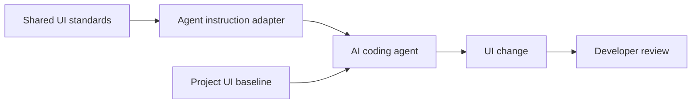

# AI Agent UI Standards

A framework-agnostic onboarding kit for AI coding agents. It maps existing frontend architecture, guides initial decisions for new projects, and turns agreed UI conventions into a reusable project baseline.

The standards are the source of truth. Agent-specific instruction files are adapters that point to them; they should not fork or redefine the guidance. The resource is designed to help a team understand its project first, then adopt only the setup it needs.

## How the pieces fit

The standards hold reusable guidance, the adapter tells the agent where to find it, and the project baseline records local facts and choices. The agent uses those inputs for a UI change, which the developer reviews.



## Quick start

Try the discovery workflow before changing code. Ask your coding agent:

```text
Read AGENTS.md and guides/project-discovery.md. Inspect this repository in
read-only mode. Classify it as an established project, new project with
constraints, or empty/unclear. Report the application structure, UI patterns,
styling and tokens, state and data boundaries, and available verification
commands. Cite repository paths for observations, separate facts from
inferences, and list unknowns. Do not edit files or recommend a rewrite.
```

Review the result, correct anything the agent inferred incorrectly, and record confirmed conventions in [`templates/project-ui-baseline.md`](templates/project-ui-baseline.md). See the [sample discovery output](examples/project-discovery-output.example.md) for the expected level of detail. For a new project, use the [architecture setup guide](guides/project-discovery.md#new-project-guide-decisions-in-context) to agree on the initial structure before scaffolding.

## Adoption path

1. Choose an adoption path in [Adopting the standards](guides/adopting-the-standards.md): an existing project or a new project.
2. Ask your AI agent to follow [Project discovery](guides/project-discovery.md). It maps the architecture and UI conventions before recommending changes.
3. Record confirmed facts, unknowns, and team choices in the [Project UI baseline](templates/project-ui-baseline.md). For a new app, use the architecture decision prompts in the discovery guide before choosing a structure.
4. Add a short pointer to this resource in the instruction file your agent uses. Start from the [adapter example](examples/agent-adapter.example.md) and keep the canonical standards available in the repository.
5. Make a small UI change, then review it with the [UI review checklist](templates/ui-review-checklist.md).

You can adopt this incrementally. Discovery does not require a framework choice or trigger a rewrite. In an existing application, preserve deliberate conventions; in a new application, the agent helps compare options against your requirements and records the decision before scaffolding.

## Adoption guides

- [Adopting the standards](guides/adopting-the-standards.md): a short setup path for existing and greenfield projects.
- [Project discovery](guides/project-discovery.md): what the agent inspects, how it reports findings, and how to guide initial architecture decisions.
- [Roadmap](ROADMAP.md): current focus and possible next steps.

## Standards

- [Architecture](standards/architecture.md): inspect first, preserve boundaries, and make the smallest coherent change.
- [Design system](standards/design-system.md): centralize and reuse design decisions.
- [Component guidelines](standards/component-guidelines.md): build focused, reusable components with clear APIs.
- [Styling guidelines](standards/styling-guidelines.md): follow project styling conventions and avoid arbitrary values.
- [Accessibility](standards/accessibility.md): support semantic, keyboard, and assistive-technology use.
- [Responsive design](standards/responsive-design.md): adapt content and interactions to available space and input modes.
- [Code quality](standards/code-quality.md): keep UI code understandable, consistent, and maintainable.
- [Optional UI integration](standards/ui-integration.md): coordinate frontend work with APIs, authentication, and service boundaries.

## Examples and templates

- [SCSS design tokens](examples/design-tokens.example.scss)
- [CSS design tokens](examples/design-tokens.example.css)
- [Component structure](examples/component-structure.example.md)
- [Agent adapter](examples/agent-adapter.example.md)
- [Project discovery output](examples/project-discovery-output.example.md)
- [UI review checklist](templates/ui-review-checklist.md)
- [Project UI baseline](templates/project-ui-baseline.md)

Examples illustrate possible implementations. Adapt their syntax and values to the project's stack; they are not framework requirements.

## Agent adapters

Use the smallest adapter the agent needs. Keep project-specific choices in the project baseline and keep the detailed, reusable guidance in `standards/`. The agent should discover the instruction mechanism supported by its current environment; the examples below are starting points, not promises about product behavior.

| Agent | Adapter location | Suggested setup |
| --- | --- | --- |
| Claude Code | `CLAUDE.md` or project instructions | Add a short pointer to `AGENTS.md` and the relevant standards. |
| Cursor | `.cursor/rules/` | Add a rule that references `AGENTS.md` and the relevant standards. |
| GitHub Copilot | `.github/copilot-instructions.md` | Add a pointer to `AGENTS.md` and applicable standards. |
| Windsurf | Workspace rules or `AGENTS.md` | Reference the canonical standards from workspace instructions. |
| OpenAI Codex | `AGENTS.md` | Use the included `AGENTS.md` directly. |
| Other agents | Their project instruction mechanism | Point to `README.md`, `AGENTS.md`, and relevant standards. |

These are integration suggestions, not guarantees about each product's current instruction discovery behavior. Check the agent's documentation and avoid maintaining multiple conflicting copies of the standards.

## Contributing

Propose changes to the canonical standards first. Keep guidance actionable, framework-neutral, and compatible with incremental work in existing applications. Update examples or templates when a standards change affects them.

## License

This project is licensed under the [MIT License](LICENSE).
