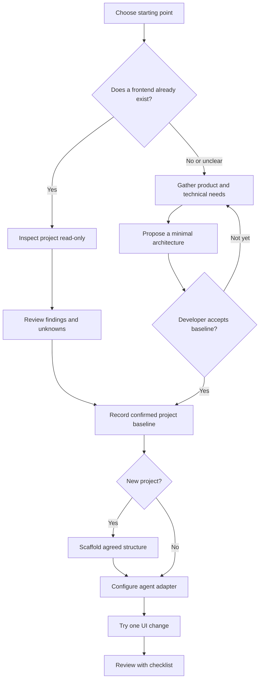

# Adopting the standards

This guide gives a lightweight path for using the standards in an existing application or establishing a baseline for a new one. You do not need to adopt every document or make a large upfront architecture decision.

## 1. Keep the standards accessible

Choose how the standards will live with the project:

- **Copy or vendor** the repository when the team wants versioned guidance alongside the code.
- **Link to it** from project instructions when the canonical copy is available to the agent in its working environment.
- **Select the relevant documents** for smaller projects, while keeping this README and `AGENTS.md` available as the entry point.

Avoid a stale copied snapshot that silently diverges from the canonical standards. If the files are copied, decide how updates will be reviewed and applied.

## 2. Choose your starting path

The two paths meet at a reviewed project baseline. Existing projects begin with evidence from the code; new projects begin with requirements and developer-approved decisions.

In an existing app, the baseline captures current conventions. In a new app, the developer confirms the baseline before the agent scaffolds the agreed structure. Both paths then use the same adapter and review checklist.

### Existing application

1. Ask the agent to follow [Project discovery](project-discovery.md) in read-only mode.
2. Review the discovery summary. Correct misunderstandings and resolve only the unknowns that affect current work.
3. Fill the project-specific parts of [`../templates/project-ui-baseline.md`](../templates/project-ui-baseline.md). Label findings as observed, chosen, unknown, or not applicable.
4. Add the short [agent adapter](../examples/agent-adapter.example.md) to the project's supported instruction file.
5. Apply the standards to the next requested UI change. Refine the baseline as the team learns; do not start with a migration just to conform to the template.

### New or empty application

1. Describe the product, audience, core screens, expected scale, delivery constraints, and known technology requirements.
2. Ask the agent to use the questions in [Project discovery](project-discovery.md) to identify unanswered architecture choices.
3. Review a small proposed baseline with tradeoffs. Decide the framework or rendering approach, route organization, component boundaries, styling and token approach, data boundary, and verification commands only as needed.
4. Record confirmed choices in the project UI baseline before scaffolding. Mark unresolved items as unknown rather than inventing requirements.
5. Scaffold only the agreed structure, then inspect the generated app and refine the baseline to match reality.

The standards intentionally do not select a universal framework, folder tree, styling tool, or state library. Choose based on the product and team constraints, and keep the first architecture easy to change.

## 3. Configure the agent

Add a concise pointer in the instruction mechanism your agent supports. The pointer should tell the agent to:

- Read this resource's `AGENTS.md` and relevant standards.
- Follow project discovery before recommending an architecture in an unfamiliar or greenfield project.
- Treat the project UI baseline as project-specific configuration.
- Preserve the established project architecture and ask before broad structural changes.

Use the [adapter example](../examples/agent-adapter.example.md) as source text, then adjust file paths to match where the resource lives. Product instruction mechanisms change over time, so confirm the supported location in the agent's current documentation.

## 4. Keep setup proportional

For a small project, the README, `AGENTS.md`, a short project baseline, and the review checklist may be enough. Add deeper standards or optional UI integration guidance when the work needs them. Revisit the baseline when the architecture, component library, or project constraints change.
